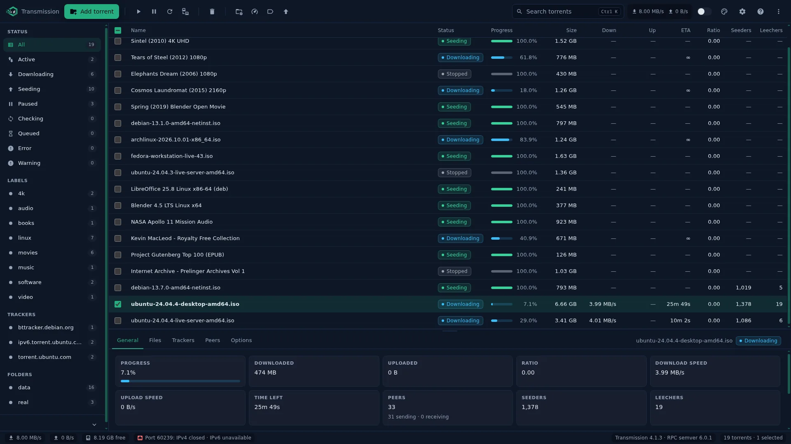
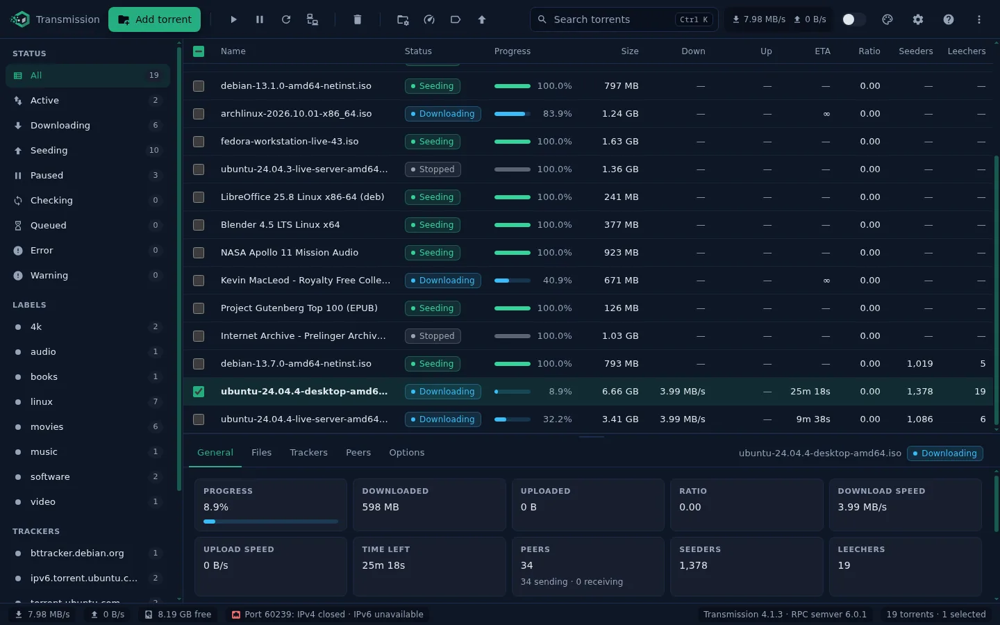
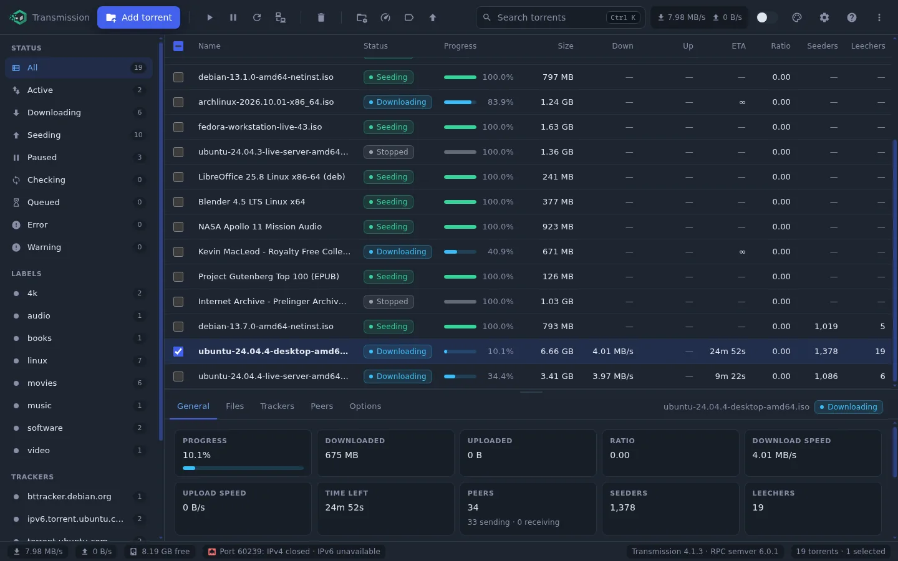
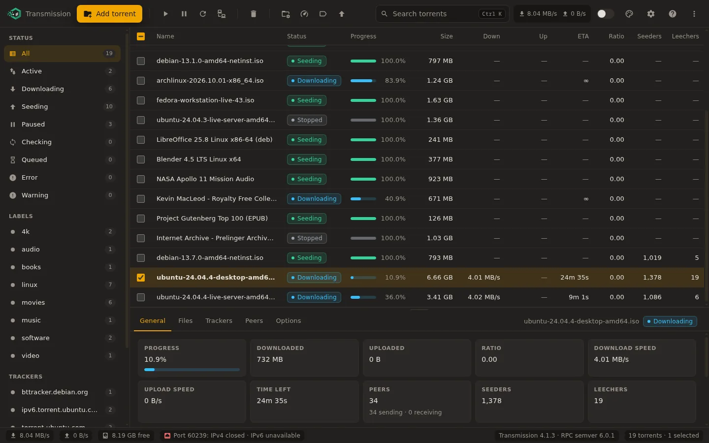
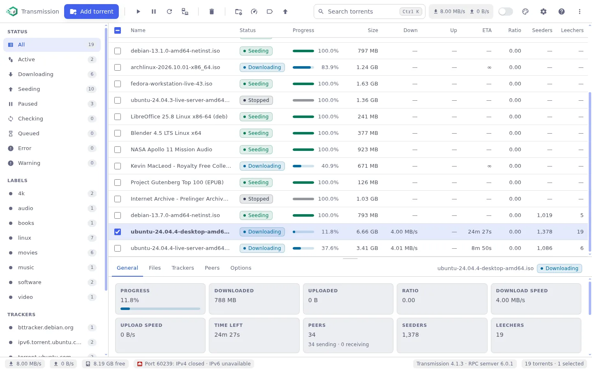
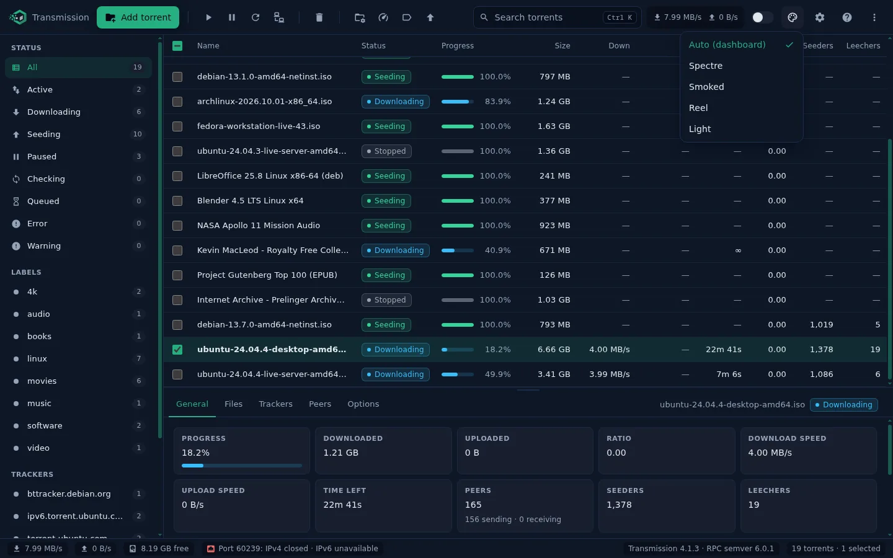
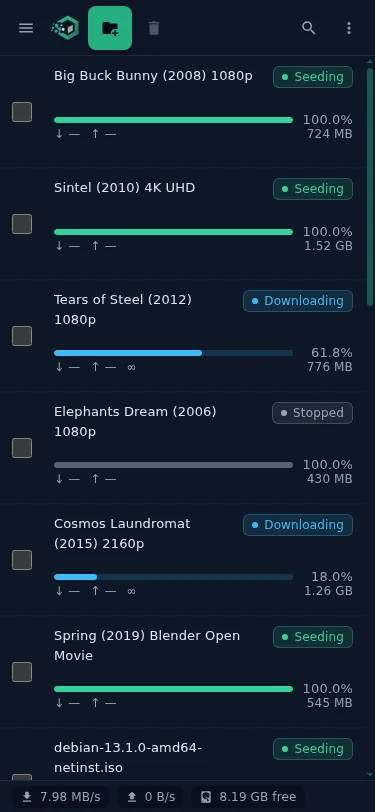
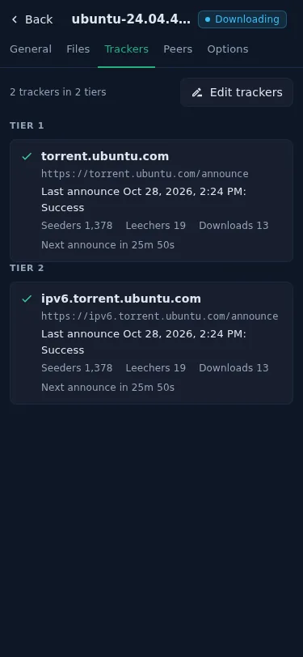
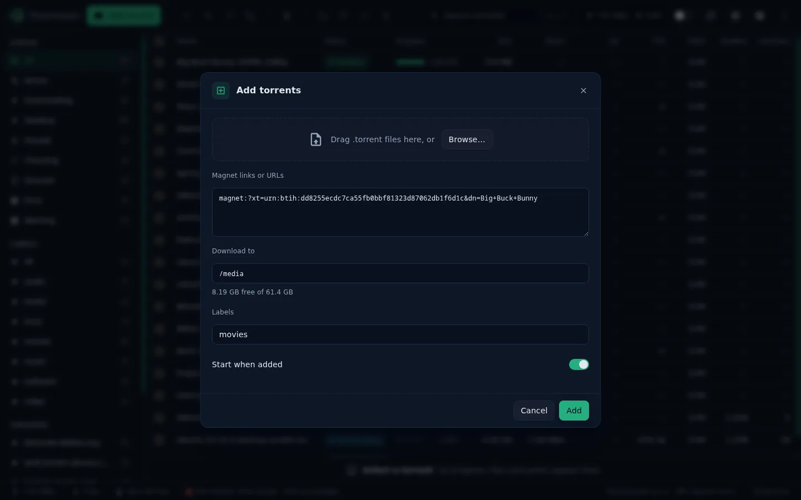
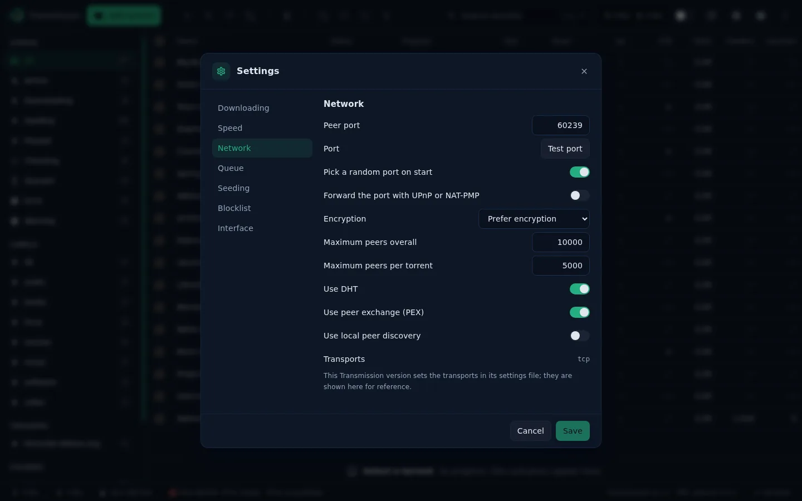

# Transmission web interface for QuickBox

This is the web UI that QuickBox installs for Transmission. It replaces the stock interface with one that looks and behaves like the QuickBox dashboard: same themes, same density, same keyboard habits. It is a static app. It talks to the Transmission daemon over its RPC endpoint and nothing else.



## Screenshots

Four themes that match your QuickBox dashboard.

| Spectre | Smoked |
|---------|--------|
|  |  |
| **Reel** | **Light** |
|  |  |

Auto follows the theme you pick in the dashboard and switches with it.



On a phone the list becomes cards and the details open full screen.

| Torrent list | Details |
|--------------|---------|
|  |  |

Add torrents by file, magnet link or drag and drop, and see the free space before you start.



Every daemon setting in one place, grouped by page.



## Supported Transmission versions

| Transmission | RPC | What the UI does |
|---|---|---|
| 2.94 | 15 | Full control. Labels are kept in the browser. |
| 3.00 | 16 | Native labels, shared with every other client. |
| 4.0.x | 17 | Tracker lists edited as tiered text. |
| 4.1.x | 19, semver 6.x | JSON-RPC 2.0 on the wire, sequential download, IPv4 and IPv6 port checks. |

The UI detects the daemon once at startup and turns features on or off from that. Nothing is hard coded to a version number.

## Features

- Torrent list that stays fast with thousands of torrents. Only the rows on screen are rendered. Sort by any column, pick the columns you want, and switch to compact rows in Settings.
- Sidebar filters for status, labels, trackers and folders, with live counts.
- Search with `Ctrl K`. Multi-select with click, Shift and Ctrl, or the keyboard. Bulk start, pause, remove, move, speed limits, queue order.
- Details for the selected torrent: general info, files with per-file priority, trackers, peers and per-torrent options.
- Add torrents by file, magnet link or drag and drop. Remove with or without data. Set location, rename, labels, replace trackers across torrents, and point a torrent at data that already exists on disk.
- Settings for the daemon: downloading, seeding, speed and schedule, peers, network and the peer port test.
- Status bar with live rates and limits, temporary speed limits, free space, port status and the daemon version.
- Four themes that follow the QuickBox dashboard: Spectre, Smoked, Reel and Light. Works from 375 px phones to 1920 px desktops. Screen reader friendly: the list is a real grid, every control has a name, and there are no native tooltips.

Torrent names, tracker messages and peer client strings are always rendered as text. The app never builds HTML from data.

## Install with QuickBox

The interface ships with QuickBox. Installing Transmission for a user installs the interface with it, from the newest verified release, and updating Transmission refreshes it. Replace `username` with the QuickBox user:

```sh
sudo qb install transmission -u username
sudo qb update transmission -u username
sudo qb reinstall transmission -u username
sudo qb remove transmission -u username
```

`qb install transmission -u username --v4` installs the newest Transmission 4 build. `qb install transmission -u username --v3` installs the 3.x line. `qb install transmission -u username -o '4.1.3'` installs one exact version; `qb help transmission` lists the versions available on your server. Open Transmission from the QuickBox dashboard or at `/transmission/web/` on your server.

To go back to the interface that comes with Transmission, open `index.original.html` in the same folder, or use the link in the About dialog.

## Install without QuickBox

You can use the interface with any Transmission 2.94 or newer. The daemon serves its web interface from one folder; the interface is placed into that folder next to the files Transmission ships, so the stock icon and the original interface stay available.

Find the folder the running daemon serves. The daemon binary decides the prefix: a package under `/usr` serves from `/usr/share/transmission`, a build under `/usr/local` from `/usr/local/share/transmission`; inside it, Transmission 4.x uses `public_html` and 3.x uses `web`. This resolves the folder from the running daemon and keeps it in `WEB`:

```sh
BIN=$(readlink -f /proc/$(pgrep -o -x transmission-da)/exe); case "$BIN" in /usr/local/*) P=/usr/local/share/transmission ;; *) P=/usr/share/transmission ;; esac; for d in "$P/public_html" "$P/web"; do [ -f "$d/index.html" ] && WEB=$d && break; done; echo "$WEB"
systemctl show transmission-daemon -p Environment
```

If the second command shows `TRANSMISSION_WEB_HOME`, the daemon serves that folder instead; use it as `WEB`.

### Coming from the original Transmission Web Control

If you installed the original project with its installer, it moved Transmission's own page to `index.original.html` and put its interface in `tr-web-control/`. Put the stock page back first, then follow one of the paths below. This is the old installer's own revert:

```sh
sudo rm -rf "$WEB/tr-web-control" "$WEB/favicon.ico" "$WEB/index.mobile.html" && sudo mv "$WEB/index.original.html" "$WEB/index.html"
```

### From the release archive (recommended)

Releases are at https://github.com/QuickBox/transmission-web-control/releases/latest. Each one ships `transmission-web-control-vX.Y.Z.tar.gz` and `SHA256SUMS`. Set `VER` to the version shown there, then download and verify:

```sh
VER=2.0.0
curl -fLO "https://github.com/QuickBox/transmission-web-control/releases/download/v$VER/transmission-web-control-v$VER.tar.gz"
curl -fLO "https://github.com/QuickBox/transmission-web-control/releases/download/v$VER/SHA256SUMS"
sha256sum -c SHA256SUMS --ignore-missing
```

Install or update with one block. The first line refreshes the pristine copy of the stock folder whenever the served page is Transmission's own: on the first install, or after a package upgrade put the stock page back. That copy leaves out the files this interface adds. Every run then builds a fresh folder from that copy, adds the stock page as `index.original.html`, unpacks the archive into it, and swaps it in. Each later step runs only if the one before it worked, so a failed step leaves the served folder untouched. The archive holds one top-level `src` folder, so `--strip-components=1` puts `app/`, `index.html`, `index.mobile.html` and `LICENSE` straight into place:

```sh
if ! grep -qE 'app/js/main\.js|tr-web-control' "$WEB/index.html"; then sudo rm -rf "$WEB-original" && sudo cp -a "$WEB" "$WEB-original" && sudo rm -rf "$WEB-original/app" "$WEB-original/index.mobile.html" "$WEB-original/index.original.html" "$WEB-original/LICENSE"; fi
[ -f "$WEB-original/index.html" ] &&
sudo rm -rf "$WEB.new" && sudo cp -a "$WEB-original" "$WEB.new" &&
sudo cp "$WEB-original/index.html" "$WEB.new/index.original.html" &&
sudo tar -xzf "transmission-web-control-v$VER.tar.gz" --strip-components=1 -C "$WEB.new" &&
sudo rm -rf "$WEB" && sudo mv "$WEB.new" "$WEB"
```

No restart is needed. Reload the Transmission page in your browser. To update, download the new archive and run the same block again; it rebuilds from the pristine copy, so files a newer release dropped do not linger. After a Transmission upgrade, run the block again; it picks up the upgraded stock files. On QuickBox, `qb update transmission` takes care of all of this.

### From a git clone

`main` is the release branch. Clone it and use the same block, copying the interface files in place of unpacking the archive:

```sh
git clone --branch main https://github.com/QuickBox/transmission-web-control.git
if ! grep -qE 'app/js/main\.js|tr-web-control' "$WEB/index.html"; then sudo rm -rf "$WEB-original" && sudo cp -a "$WEB" "$WEB-original" && sudo rm -rf "$WEB-original/app" "$WEB-original/index.mobile.html" "$WEB-original/index.original.html" "$WEB-original/LICENSE"; fi
[ -f "$WEB-original/index.html" ] &&
sudo rm -rf "$WEB.new" && sudo cp -a "$WEB-original" "$WEB.new" &&
sudo cp "$WEB-original/index.html" "$WEB.new/index.original.html" &&
sudo cp -a transmission-web-control/src/. "$WEB.new/" &&
sudo cp transmission-web-control/LICENSE "$WEB.new/" &&
sudo rm -rf "$WEB" && sudo mv "$WEB.new" "$WEB"
```

A clone is not stamped with a version, so a browser may keep older modules cached across updates. The release archive is the better path for a server you keep.

### Alternative: a separate folder

Transmission can serve any folder you name in `TRANSMISSION_WEB_HOME`. Unpack the archive anywhere, point the daemon at the `src` folder inside it, and restart:

```sh
sudo mkdir -p /opt/transmission-web-control
sudo tar -xzf "transmission-web-control-v$VER.tar.gz" -C /opt/transmission-web-control
sudo systemctl edit transmission-daemon
```

In the editor, add `[Service]` and `Environment=TRANSMISSION_WEB_HOME=/opt/transmission-web-control/src`, save, then run `sudo systemctl restart transmission-daemon`. This path loses two things: the browser tab icon, which the interface expects from the stock folder, and the About link to the original interface.

### Switching back

Open `index.original.html` in the web folder, or restore the pristine copy:

```sh
sudo rm -rf "$WEB" && sudo cp -a "$WEB-original" "$WEB"
```

## Themes and language

The UI reads the dashboard's `qb_theme` cookie and follows it. You can also pick a theme from the palette button in the toolbar; that pick is remembered in this browser and wins over the cookie.

The language follows the dashboard's `Language` cookie, then the browser language. The interface is fully translated into the dashboard's languages: English, Danish, German, Spanish, French, Brazilian Portuguese and Simplified Chinese. Ten more languages keep the strings the original project had translated and show English for the rest.

## Development

The app is plain ES modules, CSS and JSON. There is no build step and no dependency to install. Node 22 runs the checks:

```sh
bash bin/ci-local.sh
```

That runs the static gates (`node tools/check.mjs`), a syntax check of every module, the test suite, and the commit message and version checks, in the same order as CI. Tests run against recorded RPC captures from Transmission 2.94, 3.00, 4.0.6 and 4.1.3, so a change is checked against every supported daemon without one running.

Contribution guidelines, the gates and the commit rules are in `CONTRIBUTING.md`.

## Releases

Development happens on `devop`; `main` is the release branch. A push to `main` derives the next version from the commit subjects, writes the changelog, tags, and publishes a stamped tarball of `src/` with its checksum. QuickBox installs pull that tarball through the QuickBox release service.

Release notes are in `CHANGELOG.md`. Notes from before the QuickBox version are in `CHANGELOG-EN.md`.

## Support

Support is given only on the QuickBox Discord server: https://discord.gg/mca7RSv5pa. Issues are not tracked on this repository.

## Credits and license

Based on Transmission Web Control by ronggang (MIT). The QuickBox version is a rewrite of the interface under the same license; see `LICENSE`. Icon glyphs are from Material Design Icons; see `src/app/NOTICE`.
